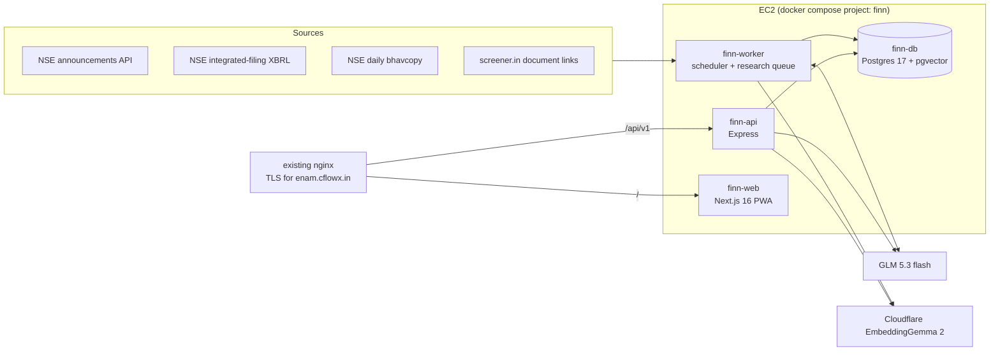

# FINN

A mobile-first investor agent for an 18-stock NSE portfolio, built for the ENAM Holdings challenge.

- **Push mode (Today).** NSE corporate announcements for the portfolio, sorted into *Act*, *Know* and *Noise*, with results cards built from exchange XBRL, management-change cards, and price, volume and filing alerts written in plain English.
- **Pull mode (Ask).** Research any NSE ticker using only its annual reports and earnings-call transcripts. Every claim carries a verbatim, page-level citation. The **Promise Ledger** checks what management guided against what was later reported.

Live demo: `https://enam.cflowx.in` (private; open the link you were sent, which sets a 30-day cookie).

## Architecture



### Repository layout

npm workspaces, TypeScript (strict), ESM, run with `tsx`.

| Package | Responsibility |
|---|---|
| `packages/shared` | Zod contracts shared by API and web, taxonomy, ports (`LlmPort`, `EmbeddingPort`, `AnnouncementClassifier`, `CardEnricher`), reader-facing reason wording |
| `packages/db` | Migrations, seed, one repository per aggregate (each takes a `sql` handle) |
| `packages/sources` | Allow-listed HTTP client (every redirect hop re-checked), NSE, screener and Yahoo adapters, PDF text extraction |
| `packages/financials` | XBRL parser and per-family metric strategies (industrial, banking, NBFC), results cards |
| `packages/domain` | Pure logic: rule classifier, scoring, clustering, alert evaluation, rule-text parser, weight learning |
| `packages/ai` | LLM client (cache, ledger, circuit breaker, daily budget), embeddings, hybrid retrieval, citation validator, Promise Ledger, research modules |
| `apps/worker` | CLI and daemon: ingest, results, EOD prices, alerts, master list, documents, research queue |
| `apps/api` | Express API: composition root in `container.ts`, routes → services → repositories |
| `apps/web` | Next.js 16 PWA: Today, Ask, Watch, Holdings, Engine |

Dependencies point inward: apps depend on packages, `domain` and `financials` have no I/O, and adapters implement the ports in `shared`, so the LLM or embedding provider is one file to swap.

### Push mode

1. The worker polls NSE announcements from a watermark (with overlap, so a missed tick just catches up later).
2. The **rule classifier** assigns a category from the NSE subject and text. Only low-confidence rows go to the LLM classifier, and only rows that are not known routine buckets.
3. **Score** = `clamp(category base × user weight × impact)`, from 0 to 100. *Act* is 70 or more, *Know* is 35–69, and anything lower is *Noise*. User weights move with explicit feedback (useful, not useful, mute).
4. Related filings are **clustered** (same company, same event), so one head item shows "2 linked".
5. Results, management changes, M&A, ratings, fund-raises, pledges and insider trades are **enriched** into cards. Results come from XBRL, not from the LLM.
6. **Alerts** run on EOD prices and new filings. Each has an `event_key`, so re-runs never double-alert. Rules can be written in plain English ("tell me when any bank falls more than 4%") and are previewed against the last 30 sessions before saving.

### Pull mode

1. `POST /research-runs` inserts a queued row. A partial unique index allows one active run per symbol, and a daily quota caps cost.
2. The worker claims runs with `FOR UPDATE SKIP LOCKED`, finds documents (annual reports and transcripts via screener.in links to BSE and NSE PDFs), extracts and chunks the text, and embeds it.
3. Progress events are written to Postgres and streamed over **SSE** with `Last-Event-ID` resume.
4. Modules: business snapshot, financial snapshot, cash quality, bull and bear case, and the Promise Ledger.
5. **Grounding.** Retrieval fuses full-text and vector search (RRF, k = 60). Every claim must cite a chunk, the quote must appear verbatim in it, and every number must appear in a cited source (within 1%) or in computed financials. A failing claim is regenerated once; if it still fails, it is shown as "could not be grounded", never silently kept.
6. **Promise Ledger.** Guidance is extracted from transcripts into a closed metric taxonomy, restatements are de-duplicated, and each promise is matched against reported numbers. The verdict is *delivered*, *missed*, *pending* or *quietly dropped* (absent from at least two later calls with no withdrawal). The summary is a fraction ("3 of 5 delivered"), never a credibility score.

### Financial definitions

- Quarter values use the `OneD` XBRL context and year-to-date values use `FourD`. Q1 filings have no `FourD`.
- **EBITDA (computed)** = profit before exceptional items and tax + finance costs + depreciation and amortisation − other income. Exceptional items are excluded; for example, TCS reported a −₹668 crore exceptional item in one year-to-date period. Banks and NBFCs show NII, pre-provision operating profit and PAT instead of EBITDA.
- Internal identity checks replace a cross-check against screener (both come from the same filings): PBT = profit before exceptional items + exceptional items, and total income = revenue + other income.

## Running locally

```bash
docker compose up -d                 # Postgres + pgvector on localhost:54329
cp .env.example .env                 # fill in LLM and Cloudflare keys
npm ci
npm run migrate -w @finn/db && npm run seed -w @finn/db
npm run dev -w @finn/api             # :4000
npm run dev -w @finn/web             # :3000, or NEXT_PUBLIC_USE_MOCKS=1 for the UI with no backend
npm run worker -- ingest             # see `npm run worker -- --help`
```

Tests: `npx vitest run` (about 1,430 tests over packages, API and worker; database tests use the local Postgres) and `npm test -w @finn/web` (81 web tests). CI runs both, plus typechecks, the mock contract check and the web build.

## Production (EC2)

FINN runs as its own compose project on a shared EC2 host (aarch64, 4 vCPU, 8 GB) alongside existing services. It publishes **no host ports**. The existing nginx terminates TLS and reaches FINN by container name on the shared `lioxi-dashboard_default` network.

| Container | Role | Memory limit |
|---|---|---|
| `finn-db` | Postgres 17 + pgvector, volume `finn_pg` | 768 MB |
| `finn-migrate` | Runs migrations and seed, then exits | — |
| `finn-api` | API on `finn-api:4000` | 384 MB |
| `finn-web` | Next.js on `finn-web:3000` | 384 MB |
| `finn-worker` | Scheduler and research queue | 1.5 GB |

Worker schedule (IST): ingest every 10 minutes from 08:00 to 23:00 and hourly otherwise; EOD prices every 30 minutes on weekdays from 18:30 to 23:30 until the bhavcopy is published; results backfill daily at 21:00; master list on Sundays at 06:00.

**Ingress** (`deploy/ec2/nginx/`): port 80 serves the ACME webroot and 301-redirects everything else to HTTPS. Port 443 proxies `/api/v1/` to `finn-api` with buffering off (for SSE) and everything else to `finn-web`. The Let's Encrypt certificate renews with the host's existing renewal cron.

### Runbook

```bash
ssh -i kimde.pem ec2-user@<host>
cd ~/finn/app && git pull
cd deploy/ec2
docker compose --env-file .env.production build finn-migrate
docker compose --env-file .env.production up -d
docker compose --env-file .env.production logs -f finn-worker

# one-off jobs
docker compose --env-file .env.production exec finn-worker node --import tsx apps/worker/src/cli.ts research --symbol ASTRAL
```

`deploy/ec2/.env.production` (mode 600, never committed) is created from `deploy/ec2/env.production.example`. `--env-file` is required because compose interpolates `POSTGRES_PASSWORD`.

The GitHub Actions workflows (`ingest`, `eod`, `research`) are manual fallbacks only; the daemon replaced their schedules, and the production host holds no GitHub token.

## Decisions and trade-offs

- **Scraping and terms of service.** NSE's JSON endpoints and archives are public but undocumented, so requests go through one allow-listed client with retries and a size cap, polling is a few requests every 10 minutes, and every source reports into a source-health table. A failing source shows up on the Engine page instead of failing silently. Prices come from NSE's official daily bhavcopy (one file a day for all stocks); Yahoo is a fallback only. screener.in is used to *find* annual-report and transcript PDFs (fetched from BSE and NSE) and for its standardised multi-year history. Results cards and push mode use exchange XBRL only. Research claims cite filing pages. The research financial snapshot and the Promise Ledger's reported actuals use screener's history (it covers any ticker, not just the portfolio), and every such number is labelled "screener.in, standardised from company filings".
- **Postgres as the queue.** A table queue with `SKIP LOCKED` replaced pg-boss, so there is one fewer moving part, and research progress is just rows the API streams over SSE.
- **SSE instead of Supabase Realtime**, so there is no database key in the browser and a single read path. The browser only ever talks to the same-origin API.
- **Deterministic first, LLM second.** Classification, scoring, clustering, alerts, financial metrics and Promise Ledger matching are deterministic and unit-tested. The LLM classifies only what the rules can't, writes one-liners and cards, extracts guidance and drafts research, and everything it returns is schema-validated and grounded.
- **Cost controls.** LLM responses are cached by prompt hash, every call is recorded, there is a daily call budget (IST) and a circuit breaker, and research runs are capped per day. When the LLM is unavailable, push mode falls back to rules alone.

## Deliberately left out

Multi-user accounts (a single private demo token instead), intraday prices, OCR for scanned PDFs (they are detected and flagged), the BSE announcements feed (it blocks automated access), news and broker notes (excluded by the brief), a composite credibility score, and Supabase Realtime.
